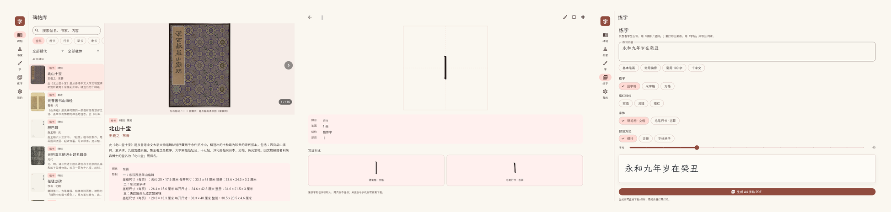

<div align="center">


# 字 · huazi

**离线的中文书法练习工具** — 碑帖、字形、字帖，手机与桌面都能用。

[](https://github.com/vaaandark/huazi/releases)
[](https://github.com/vaaandark/huazi/actions/workflows/build.yml)
[](LICENSE)
[](https://flutter.dev)
[](#下载)

**[在线试用](https://vaaandark.top/huazi/)** · **[下载](#下载)** · **[功能](#功能)** · **[开发](#开发)** · **[数据与许可](#数据与许可)**



</div>

---

## 为什么做这个

练字时反复遇到三个问题：

- 想知道**一个字有哪几种写法**，得在好几个网站之间跳，还常常加载不出来；
- 想临某本帖，**高清图要么收费，要么只能在线看**，地铁上没网就废了；
- 想打印一张**米字格字帖**，得打开 Word 手动排版。

`huazi` 把这三件事放到一个离线应用里：42 种碑帖随手翻，6763 个字能看笔顺和结构，
选几个字直接导出 A4 字帖。**不联网也能用**，数据全部内置。

## 功能

### 碑帖库 · 42 种

- 按 **书体 / 朝代 / 载体**（碑刻 · 刻帖 · 墨迹 · 墓志 · 摩崖 · 造像 · 写经）三维筛选
- 大图翻页：左右箭头、`←` `→` 键、拖动皆可；放大后拖动平移
- 著录信息：书家、行数、满行字数、形制、收藏地、拓本类型、图像许可
- **释文逐字可点**，直达单字页

### 单字页 · 6763 字

- **笔顺分步演示**（可自动播放）、笔画数、结构类型、部件分解、部首、拼音
- 并排对比：硬笔楷（文楷）· 毛笔行书（志莽）· 你自己导入的字体
- **篆书 · 隶书**字形包（12,313 个字形，覆盖 4719 字），按需下载
- 田字格 / 米字格切换，右侧书签一键加入生字本

### 练字

- **横排 / 竖排整段预览**：只想看字怎么写时，不必生成字帖
- **字帖预览**：A4 版式实时渲染，所见即所得
- 导出 PDF：田字格 / 米字格 / 方格，空临 / 浅描 / 描红三档
- 预设练习：基本笔画、常用偏旁、常用字、千字文
- 碑帖释文一键「练这一段」

### 硬笔

- 内置「硬笔楷 · 文楷」，笔画清晰、适合规范字
- 可选字体包「**瑞美加张清平硬笔行书**」：6763 字全覆盖，中性笔行书，免费商用
- **也可导入自己的字体**：单字页、字帖、临摹统一使用；PDF 会嵌入该字体

### 其他

- 生字本、数字临摹（半透明范字上直接写）
- 手机底部导航 / 桌面主从分栏，同一套代码
- 深色模式、朱砂配色、应用图标

## 下载

| 平台 | 文件 | 说明 |
|---|---|---|
| **在线试用** | [vaaandark.top/huazi](https://vaaandark.top/huazi/) | Flutter WASM，免安装 |
| Android (arm64) | [`huazi-android-arm64.apk`](../../releases/latest) | 绝大多数手机 |
| Android 模拟器 | [`huazi-android-x86_64.apk`](../../releases/latest) | x86_64 模拟器 |
| Linux x64 | [`huazi-linux-x64.tar.gz`](../../releases/latest) | 解压后运行 `bundle/huazi` |
| Windows / macOS | [Actions 产物](../../actions/workflows/build.yml) | 由 CI 构建，未签名 |

> Android 安装需允许「未知来源」。macOS 的 release 构建需要开发者证书，CI 只产出 debug 版用于验证。

## 使用

**只想看某个字怎么写** → 底部「字」→ 输入或点常用字 → 看笔顺、结构、三种写法。

**想临某本帖** → 「碑帖」→ 筛选书体/朝代 → 打开 → 左右拖动翻页；点释文里的字可查单字。

**想练一段话** → 「练字」→ 粘贴文字 → 选横排/竖排预览，或切到「字帖格子」→ 导出 PDF。

**硬笔行书** → 「我的」→ 导入字体 → 下载推荐字体包，或选自己的 `.ttf/.otf`。

## 开发

```bash
# 1. 工具链（免 root，装到 ~/opt）
bash tool/setup-toolchain.sh

# 桌面构建依赖（Ubuntu / WSL）
sudo apt install -y clang cmake ninja-build pkg-config libgtk-3-dev \
  libblkid-dev liblzma-dev libglu1-mesa-dev libgl1-mesa-dev

# 2. 第三方数据（字形库、笔顺、字体）
bash tool/fetch-vendor.sh

# 3. 数据管线 + 运行
make setup data views thumbs build
make run          # 桌面
make apk          # Android
```

数据管线是独立的 Python 工具（`datakit/`），产出一个只读 SQLite，Flutter 端只负责读：

```
书格 API ─┐
字形库   ─┼─→ datakit ─→ build/huazi.sqlite ─→ app/assets ─→ APK / 桌面 / WASM
笔顺数据 ─┤                + thumbs/
字体     ─┘                + glyphs-pack.sqlite（可选）
```

详见 [docs/ARCHITECTURE.md](docs/ARCHITECTURE.md) 与 [docs/DATA.md](docs/DATA.md)。

### 目录

```
huazi/
├── datakit/                  Python 数据管线
│   └── src/huazi_datakit/
│       ├── shuge.py          书格 API 客户端 + 页面解析
│       ├── enrich.py         书家 / 朝代 / 书体推断
│       ├── glyphdata.py      笔顺、部件、篆隶字形、字体子集
│       └── build_db.py       编译 SQLite
├── tool/                     环境与数据脚本
├── data/works/*.yaml         ★ 唯一需要长期维护的资产
├── app/                      Flutter（Android / Linux / Windows / macOS / Web）
│   ├── lib/data/             数据访问、字体、生字本
│   ├── lib/pdf/              字帖排版
│   └── lib/ui/               页面
└── .github/workflows/        构建与 Pages 部署
```

### WSL 下调试

WSLg 会把窗口直接映射到 Windows 桌面，但只有软件渲染：

```bash
export GDK_BACKEND=x11 LIBGL_ALWAYS_SOFTWARE=1
flutter run -d linux
```

Android 真机走无线调试（WSL 看不到 USB）：

```bash
adb pair 192.168.x.x:PORT && adb connect 192.168.x.x:5555
```

## 数据与许可

| 数据 | 来源 | 许可 |
|---|---|---|
| 碑帖元数据与缩略图 | [书格](https://www.shuge.org) | 逐条记录在 YAML 的 `rights` 字段 |
| 核心名碑元数据 | 手工整理 | 公有领域事实性信息 |
| 篆隶字形 | [hanzi-glyphs-svg](https://github.com/zhouyongh/hanzi-glyphs-svg) | CC0 / OFL 1.1 |
| 笔顺 | [hanzi-writer-data](https://github.com/chanind/hanzi-writer-data) | Arphic Public License |
| 结构 / 部件 | [Make Me a Hanzi](https://github.com/skishore/makemeahanzi) | LGPL / Arphic |
| 字体 | LXGW 文楷 GB、志莽行书 | SIL OFL 1.1 |
| 可选字体包 | 瑞美加张清平硬笔行书 | 免费商用（原样分发，不内置） |

- 代码以 **MIT** 释出，数据另行授权，详见 [NOTICE.md](NOTICE.md)。
- 部分碑帖图像为 **CC BY-NC 4.0**，本项目仅作个人练习与非商业用途。
- **不镜像高清原图**：只缓存 640px 缩略图并保留原始链接。
- 抓取遵守书格 `robots.txt`（不访问 `/dl/`），请求间隔 ≥1s。

## 已知限制

- 网页版受 **CORS** 限制，高清原图只能看内置 640px（界面会明确提示），桌面/手机可看原图
- 网页版不支持篆隶包与字体包下载，但**可以导入本地字体**
- 欧颜柳真迹单字切图（M5）尚未开始，这 8 本目前是元数据 + 纸色占位封面
- macOS 包需要开发者证书，仓库只保证 CI 能产出 debug 版

## 路线

| | 内容 | 状态 |
|---|---|---|
| M1 | 碑帖库 | ✅ |
| M2 | 单字页（笔顺 / 结构 / 篆隶包） | ✅ |
| M3 | 字帖生成（A4 / PDF） | ✅ |
| M4 | 生字本、数字临摹、字体导入、整段预览 | ✅ |
| M5 | 欧颜柳真迹单字切图 | 待高清拓本 |
| M6 | 分级课程（小学 300 / 1600 / 2500） | 待字表数据 |
| M7 | 竖排字帖、行气参考线 | 计划中 |

## 贡献

欢迎提 Issue 和 PR。数据类贡献最有用：补一条碑帖的著录、修一个错字、加一张可用的公有领域图源。
提交前请跑：

```bash
cd datakit && uv run huazi-data validate
cd ../app && flutter analyze && flutter test
```

## 致谢

- [书格](https://www.shuge.org) — 碑帖扫描件与著录
- [hanzi-glyphs-svg](https://github.com/zhouyongh/hanzi-glyphs-svg) — 篆隶字形
- [Make Me a Hanzi](https://github.com/skishore/makemeahanzi) / [hanzi-writer](https://github.com/chanind/hanzi-writer) — 笔顺与结构
- [LXGW 文楷](https://github.com/lxgw/LxgwWenKai)、[Zhi Mang Xing](https://fonts.google.com/specimen/Zhi+Mang+Xing) — 字体
- 张清平 — 硬笔行书字形

## License

[MIT](LICENSE) © 2026 vaaandark

